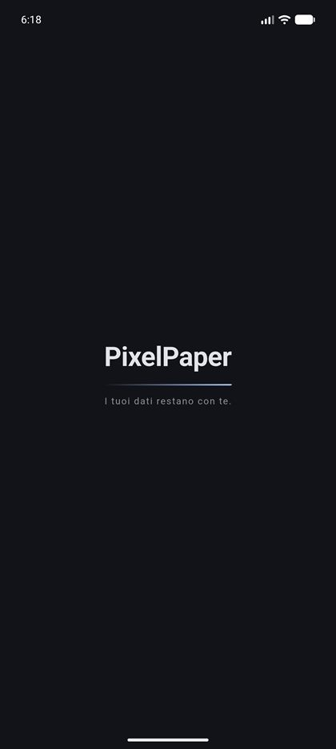
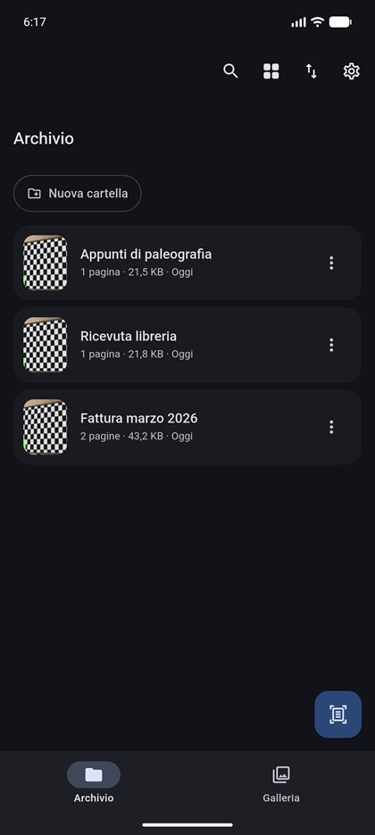
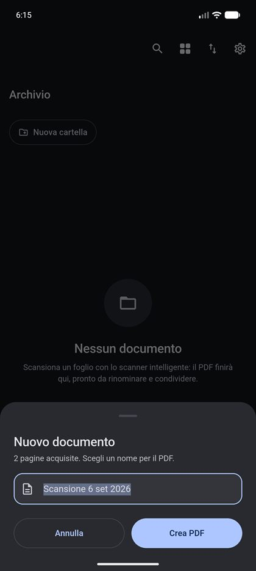
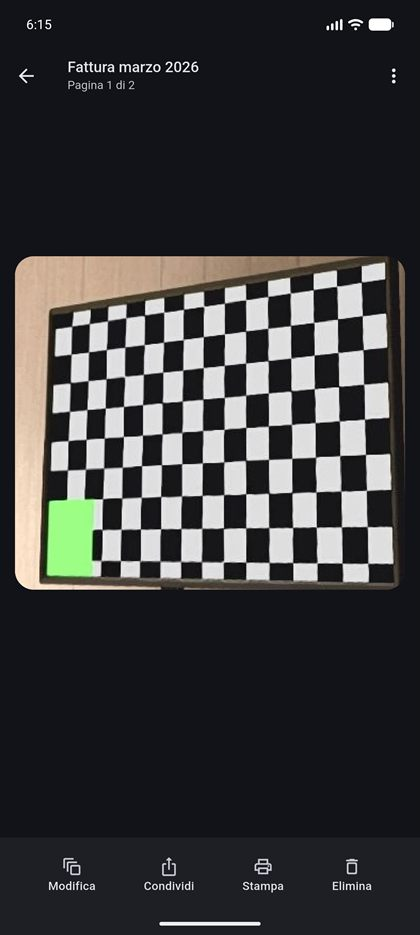
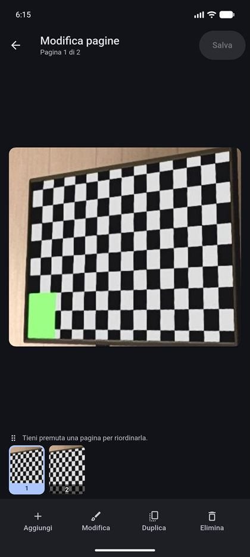
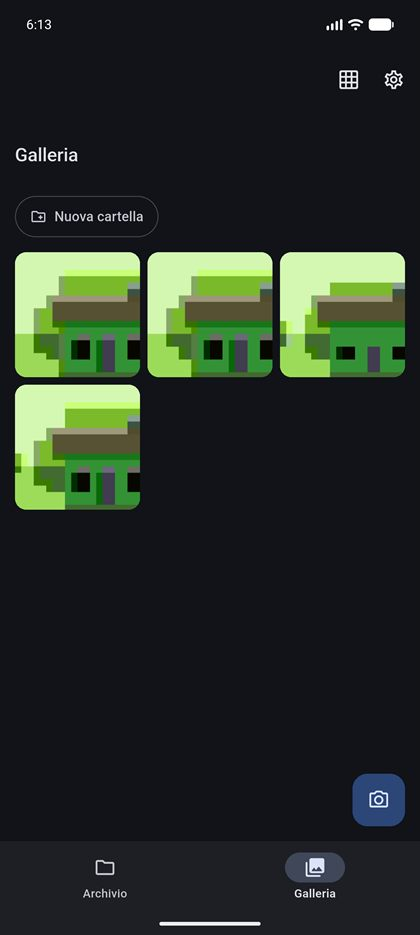
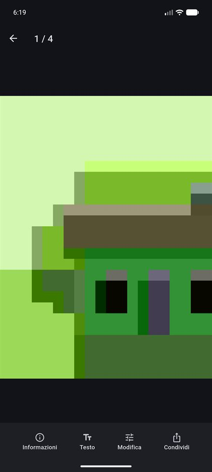
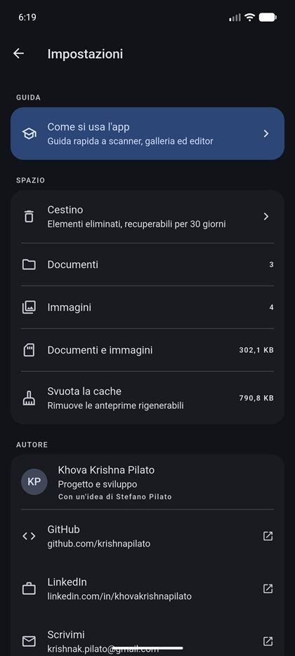

# PixelPaper

> **«I tuoi dati restano con te.»**

Scanner di documenti e archivio PDF per Android. Tutto resta sul telefono:
nessun account, nessun cloud, nessuna richiesta di rete, nessun permesso oltre
alla fotocamera.

[](https://github.com/krishnapilato/pixelpaper/actions/workflows/android.yml)

- 📲 **App su Google Play:** <https://play.google.com/store/apps/details?id=com.khovakrishnapilato.pixelpaper>
- 🧪 **Diventa tester:** <https://play.google.com/apps/testing/com.khovakrishnapilato.pixelpaper>
- 📖 **Guida:** <https://krishnapilato.github.io/pixelpaper/>
- 📦 **APK firmati:** [Releases](https://github.com/krishnapilato/pixelpaper/releases)

**Autore:** Khova Krishna Pilato ·
[GitHub](https://github.com/krishnapilato) ·
[LinkedIn](https://www.linkedin.com/in/khovakrishnapilato/) ·
[krishnak.pilato@gmail.com](mailto:krishnak.pilato@gmail.com)

<sub>Da un’idea di Stefano Pilato.</sub>

---

<table>
  <tr>
    <td align="center" width="25%">
      <br>
      <sub><b>Avvio</b><br>L’icona viene scansionata, il raggio scrive il nome</sub>
    </td>
    <td align="center" width="25%">
      <br>
      <sub><b>Archivio</b><br>Pagine, dimensione, data, cartelle</sub>
    </td>
    <td align="center" width="25%">
      <br>
      <sub><b>Nome</b><br>Chiesto dopo la scansione</sub>
    </td>
    <td align="center" width="25%">
      <br>
      <sub><b>Visualizzatore</b><br>Le pagine scorrono in verticale</sub>
    </td>
  </tr>
  <tr>
    <td align="center">
      <br>
      <sub><b>Editor pagine</b><br>Trascina la striscia per riordinare</sub>
    </td>
    <td align="center">
      <br>
      <sub><b>Galleria</b><br>Foto a piena risoluzione</sub>
    </td>
    <td align="center">
      <br>
      <sub><b>Schermo intero</b><br>Dettagli, testo, modifica, condividi</sub>
    </td>
    <td align="center">
      <br>
      <sub><b>Impostazioni</b><br>Spazio, cestino, cartella di export, licenze</sub>
    </td>
  </tr>
</table>

<sub>Screenshots taken on an Android emulator, release build. The camera and
scanner ones show the emulator's virtual scene.</sub>

---

---

## Cosa fa

| Modulo | Cosa offre |
| :--- | :--- |
| **Due schede, un pulsante** | Archivio e Galleria affiancati: tocca la barra o scorri. Il pulsante d’azione segue il dito: scansione nell’Archivio, fotocamera nella Galleria; nella Galleria una **pressione di 2 secondi importa** le foto già sul telefono. |
| **Scanner** | Il flusso ML Kit di Google: bordi, prospettiva, ombre, più pagine di fila. Scegli solo il nome. |
| **Fotocamera** | CameraX alla piena risoluzione, senza ritagli. Tocca per mettere a fuoco ed esporre, trascina per compensare, zoom, flash, autoscatto, griglia. Resta aperta tra uno scatto e l’altro. |
| **Galleria** | Foto a piena risoluzione, da due a quattro colonne. Selezionale **nell’ordine delle pagine** e “Crea album” le copia in un documento in quell’ordine. |
| **Archivio** | Lista o griglia, ricerca, ordinamento, rinomina, condividi, **esporta**, stampa. Un documento fatto di foto è un **album**: il PDF si crea solo quando lo condividi, stampi o esporti. |
| **Editor pagine** | Riordino trascinando la striscia, aggiunta da fotocamera o galleria (e pagina bianca per i PDF), modifica della pagina come immagine, duplica, elimina. |
| **Cartelle e Cestino** | Un livello di cartelle per documenti e foto. Ogni eliminazione è annullabile e resta nel Cestino 30 giorni; svuotarlo cancella davvero i file. |
| **Testo** | Riconoscimento del testo sul dispositivo (ML Kit, alfabeto latino). |

---

## Privacy e sicurezza

Privacy first non è uno slogan: ogni punto qui sotto è verificato da un test o
da un controllo della pipeline.

- **Un solo permesso: la fotocamera.** Niente internet, niente archivio,
  niente posizione. La CI fallisce se un plugin ne aggiunge uno
  (`tool/check_permissions.sh`).
- **Niente metadati in uscita.** Foto condivise e PDF esportati perdono
  coordinate GPS, modello del telefono, numeri di serie, XMP, commenti e dati
  nascosti dopo la fine dell’immagine; resta solo l’orientamento
  (`ImageSanitizer`, testato anche con migliaia di file corrotti).
- **Nessuna copia dimenticata.** I PDF creati per condividere, stampare o
  esportare vivono solo per la durata dell’operazione; all’avvio vengono
  rimossi i residui di plugin, scanner e scritture interrotte.
- **Eliminare è eliminare.** Svuotando il Cestino spariscono righe, file,
  cartelle degli album e anteprime. Il database usa `secure_delete`: i dati
  cancellati vengono sovrascritti.
- **File confinati.** Lo storage non cancella mai nulla fuori dalle due
  cartelle private dell’app, qualunque percorso gli arrivi; i nomi file sono
  ripuliti da separatori, caratteri di controllo e override bidirezionali.
- **Input ostili rifiutati.** Il formato di un’immagine si riconosce dai byte,
  non dall’estensione: file vuoti, troppo grandi o che non sono immagini non
  entrano in galleria; HEIC/WebP vengono convertiti in JPEG.
- **Scritture atomiche.** Un crash o il disco pieno lasciano il file vecchio o
  quello nuovo, mai uno a metà.
- **Nessun backup su cloud.** I dati sono esclusi dal backup Google; il
  trasferimento diretto tra due telefoni resta possibile.
- **Log puliti.** In release non vengono scritti titoli o percorsi nei log.

---

## Architettura

```
lib/
  core/       tema, motion, router, primitive di stato (Serial, LibraryRevision, Limits)
  data/       modelli immutabili, DAO sqflite, repository, servizi (storage, PDF, immagini)
  features/   una cartella per funzione: application/ (controller) + presentation/ (UI)
```

- **Stato con Riverpod 3.** Ogni libreria (archivio, galleria, cestino,
  cartelle) è un `AsyncNotifier`. Le scritture passano da una coda `Serial`:
  due operazioni sulla stessa libreria non si sovrappongono mai.
- **Niente chiamate incrociate tra controller.** Ogni scrittura incrementa
  `libraryRevisionProvider`; cartelle e cestino lo osservano e si ricalcolano
  da soli.
- **Modelli immutabili** con uguaglianza per valore: una schermata si
  ricostruisce solo se il dato è cambiato davvero.
- **Editor come controller.** Le sessioni di modifica (album e PDF) vivono in
  controller testabili; i file scritti e poi scartati vengono rimossi.
- **Nessuna attesa oltre 20 secondi.** Ogni spinner è legato a `Limits.wait`:
  oltre, l’operazione è segnalata come fallita e la schermata torna usabile.
- **PDF su PDFium** (`pdfrx`): riordino ed eliminazione di pagine spostano le
  pagine originali, vettori e annotazioni compresi, in pochi millisecondi.
- **Animazioni** sui token Material 3 e rispettose di “Rimuovi animazioni”
  di Android.

---

## Qualità

| Controllo | Dove |
| :--- | :--- |
| `flutter analyze` con `strict-casts`, `strict-inference`, `strict-raw-types` e oltre 60 regole; **unused, warning e deprecazioni sono errori** | `analysis_options.yaml` |
| La **build Gradle fallisce** se l’analisi trova anche un solo problema (task `analyzeDart`, legato a `preBuild`) | `android/app/build.gradle.kts` |
| Kotlin compila con `allWarningsAsErrors` | `android/app/build.gradle.kts` |
| Test unitari, d’integrazione (SQLite reale + file veri), di stato e di widget | `test/` |
| Fuzzing del parser JPEG/PNG, attacchi di path traversal, SQL nei nomi, impostazioni manomesse | `test/unit`, `test/data` |
| Analisi SonarQube / SonarCloud | `sonar-project.properties` |

```bash
flutter analyze --fatal-infos --fatal-warnings
dart format --output=none --set-exit-if-changed lib test
flutter test --coverage
```

> **Test su Windows:** `pdfium_dart` (usato da pdfrx) compila un piccolo
> modulo C per l’host, quindi in locale serve **Visual Studio Build Tools**
> con il carico di lavoro “Sviluppo di applicazioni desktop con C++”. Su
> Linux e macOS basta il compilatore di sistema; in CI non serve nulla.

---

## Toolchain

| Strumento | Versione |
| :--- | :--- |
| Flutter / Dart | 3.47.8 / 3.13 |
| JDK | 27 in locale (minimo 21); 25 LTS in CI |
| Gradle | 9.8.2 (la prima con supporto a Java 27) |
| Android Gradle Plugin | 9.5.0 |
| Kotlin | 2.4.21 |
| compileSdk / bytecode | 37 / Java 21 |

Tutte le dipendenze sono open source (MIT, BSD, Apache 2.0). Material arriva
dal pacchetto `material_ui`, separato dall’SDK.

Per indicare a Flutter il JDK senza dipendere da `JAVA_HOME` (che cambia a ogni
aggiornamento del JDK):

```bash
flutter config --jdk-dir="C:\Program Files\Java\latest\jdk-27"
```

> **Repository dentro OneDrive:** OneDrive blocca i file che Gradle scrive in
> `build/` mentre li sincronizza, e la build fallisce con `AccessDenied` o con
> errori di compilazione Java casuali. Tieni il repository fuori da OneDrive
> (es. `C:\dev\pixelpaper`) o metti in pausa la sincronizzazione durante la
> build.

```bash
flutter pub get
flutter run                       # debug sul dispositivo collegato
flutter build apk --release       # senza key.properties firma con la chiave di debug
```

---

## Pipeline e release

`.github/workflows/android.yml`:

1. **Ogni push e pull request** – formattazione, analisi rigorosa, test con
   copertura, build release di controllo e verifica dei permessi.
2. **Tag `v*`** (es. `v3.2.0`) – se tutto passa: controlla che il tag
   coincida con `version:` del `pubspec.yaml`, costruisce gli APK offuscati
   (uno per architettura più l’universale), verifica i permessi, calcola gli
   SHA-256 e pubblica la **GitHub Release** con le note in italiano
   (`.github/release-notes.md`).

Segreti richiesti (*Settings → Secrets and variables → Actions*):

| Segreto | Contenuto |
| :--- | :--- |
| `ANDROID_KEYSTORE_BASE64` | il file `.jks` in base64 (`base64 -w0 pixelpaper.jks`) |
| `ANDROID_KEYSTORE_PASSWORD` | password del keystore |
| `ANDROID_KEY_ALIAS` | alias della chiave |
| `ANDROID_KEY_PASSWORD` | password della chiave |

Senza segreti la release **si ferma**: un APK pubblico non viene mai firmato
con la chiave di debug.

```bash
git tag v3.2.0
git push origin v3.2.0
```

---

## Pubblicare su Google Play

1. **Crea la chiave di firma** (una volta sola, e conservala: senza non potrai
   più pubblicare aggiornamenti).

   ```bash
   keytool -genkey -v -keystore pixelpaper.jks -keyalg RSA -keysize 4096 -validity 10000 -alias pixelpaper
   ```

2. **Dichiarala in `android/key.properties`** (è in `.gitignore` insieme a
   `*.jks`):

   ```properties
   storeFile=C:/percorso/assoluto/pixelpaper.jks
   storePassword=…
   keyAlias=pixelpaper
   keyPassword=…
   ```

3. **Costruisci il bundle** da caricare in Play Console:

   ```bash
   flutter build appbundle --release
   ```

   Senza `key.properties` la build del bundle **fallisce di proposito**. Prima
   di caricarlo, controlla che lo SHA1 coincida con il certificato di caricamento
   mostrato da Play:

   ```bash
   keytool -printcert -jarfile build/app/outputs/bundle/release/app-release.aab
   ```

4. **Versione:** la riga `version:` del `pubspec.yaml`, nella forma
   `<versionName>+<versionCode>`; il `versionCode` deve superare ogni codice già
   caricato.

L’`applicationId` è `com.khovakrishnapilato.pixelpaper`.

---

## Guida web

La guida su [krishnapilato.github.io/pixelpaper](https://krishnapilato.github.io/pixelpaper/)
sta in `web/`: HTML e CSS statici, nessun framework e nessuna build.
`.github/workflows/deploy.yml` la pubblica a ogni modifica di `web/**` su `main`.

```bash
node tool/serve-web.js      # anteprima su http://localhost:4173
```

I percorsi nella pagina restano **relativi** (il sito è servito da
`/pixelpaper/`). Pages va impostato su *Settings → Pages → Source: GitHub
Actions*.

---

## Riconoscimento del testo

ML Kit con il modello **latino** riconosce un alfabeto, non una lingua:
italiano, inglese, francese e latino sì; greco, cirillico, ebraico e arabo no.
Il limite pratico è la stampa: caratteri moderni ottimi, gotico, incunaboli,
s lunga e scrittura a mano danno risultati scarsi. Per questo la galleria
conserva le foto a piena risoluzione e senza ritagli.
